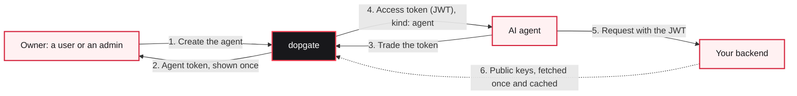

# Auth for AI agents

An AI agent that works for one of your users needs a way to call your backend. Handing it the user's password or session makes it look like the user, so your backend can't tell the two apart or limit what the agent does. In Dopgate an agent is an account of its own. It signs in with its own token, and the access token it gets says that an agent is calling, who owns it, and what it may do.

An agent can be an AI agent such as a coding assistant, a bot, or a script that should have its own identity. Every agent belongs to an owner, an admin or one of your users.

## How an agent signs in

1. The owner creates the agent, from your app or from the admin console, and gives it capabilities.
2. Dopgate answers with the agent's token. It starts with `dga_` and is shown once.
3. The agent trades that token at `POST /api/v1/auth/token`.
4. Dopgate answers with an ES256 access token whose claims include `kind: "agent"`, the `owner`, and the `capabilities`.
5. The agent sends the access token to your backend with each request.
6. Your backend verifies the signature against `/.well-known/jwks.json`, the same way it verifies a person's token, and reads the claims.

## What your backend can rely on

Dopgate signs every access token, so your backend can trust these claims without calling Dopgate:

| Claim | What it tells you |
| --- | --- |
| `kind` | `agent` for an agent, `human` for a person. Check it first. |
| `sub` | The agent's own ID, starting with `agt_`. It never changes. |
| `owner` | The ID of the user or admin who owns the agent and answers for it. |
| `capabilities` | The key-value pairs the owner gave the agent. |

A person's token has `email` and a session. An agent's token has neither.

## Agents, personal tokens, and API keys

| | Signs in as | Good for |
| --- | --- | --- |
| Agent | Itself, with an `agt_` ID and an owner | An AI agent or bot that should be limited and tracked apart from the person behind it |
| [Personal token](/guide/personal-tokens) | The user who made it | A script that acts as the user, with everything the user can do |

A shared API key tells your backend that someone has the key. An agent token tells it which agent is calling, who owns it, and what the owner allowed.

## What Dopgate leaves to your app

Dopgate stores capabilities and signs them. It never enforces them. Your backend reads the claims and decides what the agent may do. Agent tokens are also only for your backend: every Dopgate endpoint refuses them with `403 AUTHORIZATION_DENIED`, so an agent can't read a profile, make tokens, or manage other agents.

## Next steps

- [Create an agent](/ai-agents/create-an-agent) covers who can make agents, the fields, and how owners and admins manage them.
- [Capabilities in the token](/ai-agents/capabilities) has the rules for capabilities and how they reach the token.
- [Check an agent in your backend](/ai-agents/verify-in-your-backend) shows the token trade, the claims, and the check in code.
