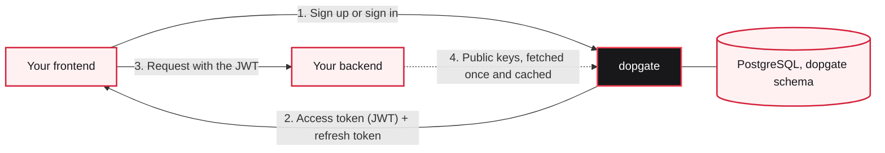

# Introduction

Dopgate is an authentication server for one app, and you run it yourself. It keeps your user accounts, signs people in, and gives your app short-lived tokens that prove who the user is. It does the job Firebase Authentication or Clerk would do, with a smaller feature set and no hosted service.

Dopgate is a standalone app. It runs in its own container, usually in the same Docker Compose stack as your app, and stores everything in PostgreSQL. The smallest setup is a PostgreSQL server and Dopgate. All of Dopgate's tables live in one schema (`dopgate` unless you pick another name), so it can share your app's database without touching your tables.

::: info Version {{version}}
Accounts, sign-in, email codes, tokens, the admin API, and the admin console work today. Single sign-on and multi-factor authentication are planned, and their routes answer `501 Not Implemented`. [Product status](/guide/product-status) has the full list.
:::

## How it fits with your app

1. Your web or mobile frontend calls Dopgate's API to sign the user up or in.
2. Dopgate answers with an access token, which is a signed JWT that lasts 15 minutes by default, and a refresh token that gets new access tokens.
3. The frontend sends the access token to your backend with each request.
4. Your backend checks the token's signature with the public keys at `/.well-known/jwks.json` and reads the user ID from the `sub` claim. It does not call Dopgate on every request.

When your backend needs to do something to an account, such as set a plan in the user's metadata or disable a user, it calls Dopgate's admin API with a service key. See [Calling the admin API](/guide/admin-api).

## What it covers

- Sign-up with an email and password, and sign-in with a password or an emailed 6-digit code
- Email verification, password reset, and email change, all by 6-digit code
- Profiles with a display name, an avatar URL, and three kinds of JSON metadata
- Access and refresh tokens, with refresh token rotation and reuse detection, and a list of signed-in devices each user can end
- Three roles: root, admin, and member
- An admin API for users, settings, email templates, signing keys, and the audit log
- Rate limits per address and per email, and account lockout after wrong passwords
- Six email templates you can rewrite from the console or the API
- A hash-chained audit log
- An admin console at `/` for root and admins

## What it leaves to your app

Dopgate answers "who is this user". Your app decides what they may do. Organizations, teams, permissions on your own data, and billing belong in your app, keyed by the user ID from `sub`. Dopgate has no hosted sign-in pages either: your frontend draws its own forms and calls the API.

## Where to go next

- [Quick start](/guide/quick-start) runs Dopgate with Docker Compose and signs you in to the console.
- [Add Dopgate to your app](/guide/add-to-your-app) wires up a frontend and a backend.
- [Running with your app's stack](/self-hosting/with-your-app) covers a real deployment next to your app.
