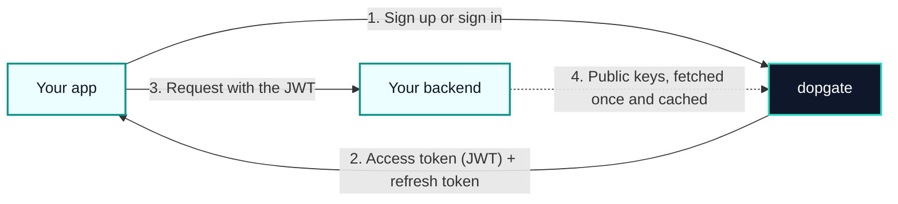

# Introduction

dopgate is an authentication server you run yourself. It keeps your user accounts, signs them in, and gives your apps tokens that prove who the user is. It plays the same role as Firebase Authentication or Clerk, with a smaller feature set and no hosted service: you run one binary, and everything it knows sits in one SQLite file next to it.

::: warning Early version
dopgate is at version {{version}}. The server, setup, the audit log, and the full API description are in place, and most endpoints answer `501 Not Implemented` until their feature lands. [Product status](/guide/product-status) lists what works today.
:::

## How dopgate works

1. Your web or mobile app calls dopgate to sign the user up or in. It identifies itself with a publishable key.
2. dopgate returns a short-lived access token, which is a signed JWT, and a refresh token that gets new access tokens.
3. The app sends the access token to your own backend with each request.
4. Your backend checks the token's signature with the keys dopgate publishes at `/.well-known/jwks.json`. It does not call dopgate on every request.

## What it covers

- Sign-up and sign-in with email and password
- Email verification and passwordless sign-in, by code or by link
- Forgot and reset password
- Access and refresh tokens, with sessions users can see and end
- Single sign-on through OpenID Connect providers
- Roles: one root account, admins, and members
- An admin API for users, apps, settings, and backups
- A hash-chained audit log
- Rate limits and account lockout
- Swagger documentation of the whole API at `/api/docs`

## What it leaves to you

dopgate decides who someone is. What they may do inside your app, beyond the root, admin, and member roles, is your backend's business. Store your own permissions in your database, keyed by the user ID in the token's `sub` claim, or keep small app-specific values in the user's metadata.

dopgate also does not draw your sign-in screens. Your app owns the UI and calls the API.

## Next steps

- [Quick start](/guide/quick-start): run dopgate and create the root account.
- [Users and roles](/guide/users-and-roles): the three roles and what each can do.
- [Tokens and sessions](/guide/tokens-and-sessions): how to verify a token in your backend.
