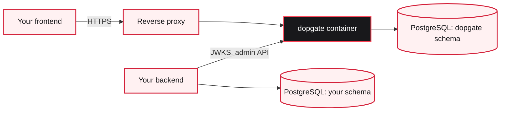

# Self-hosting

A Dopgate deployment is a PostgreSQL database and one Dopgate container. Dopgate keeps no files on disk: accounts, sessions, codes, signing keys, settings, templates, and the audit log all live in its PostgreSQL schema. You can restart, replace, or move the container freely as long as it points at the same database.

## What you need

- PostgreSQL. The bundled Compose file uses PostgreSQL 18, and the test suite runs on 17.
- A host name for Dopgate, such as `auth.example.com`, served over HTTPS. Dopgate serves the console at `/` and the API under `/api`, so give it its own host name instead of a path on your app's site.
- An SMTP server for real email. Without one, emails go to the log.

## What you set

At minimum, set `DOPGATE_DATABASE_URL` and `DOPGATE_PUBLIC_URL`. For a real deployment you will also want `DOPGATE_ALLOWED_ORIGINS`, `DOPGATE_SERVICE_KEY`, `DOPGATE_ROOT_EMAIL`, `DOPGATE_TRUSTED_PROXIES` if a proxy sits in front, and SMTP, either with the variables or in the console. [Environment variables](/reference/environment-variables) lists them all.

## Pages in this section

- [Docker image](/self-hosting/docker): build it, run it, and use it for one-off commands.
- [Running with your app's stack](/self-hosting/with-your-app): add Dopgate to your app's Compose file and put a proxy in front.
- [PostgreSQL and the schema](/self-hosting/postgres): how the schema works and how to give Dopgate its own role.
- [Email (SMTP)](/self-hosting/smtp): send real email.
- [Configuration](/self-hosting/configuration): environment variables, the optional TOML file, and the order they apply in.
- [Backups](/self-hosting/backups): `pg_dump --schema=dopgate` and restoring.
- [Upgrading](/self-hosting/upgrading): new versions and migrations.
- [Security checklist](/self-hosting/security-checklist): what to check before going live.

## Logs and health

Dopgate logs to standard error. `RUST_LOG` sets the level, `app=info,tower_http=warn` in the image. Every response carries an `X-Request-Id` header. Your app can log it next to its own errors.

`GET /api/v1/health` answers `200` with `"status": "ok"` while the database answers, and `503` with `"status": "degraded"` and `"database": "unavailable"` while it doesn't. The image's health check runs [`dopgate healthcheck`](/cli/commands#healthcheck) against it every 15 seconds.

On startup and shutdown, and whenever someone verifies the audit chain, Dopgate writes the head of the audit chain to the log as an `audit checkpoint`. Keep your logs somewhere outside the database so those checkpoints can later prove the log wasn't rewritten. See [Audit events](/reference/audit-events#verifying-the-chain).
